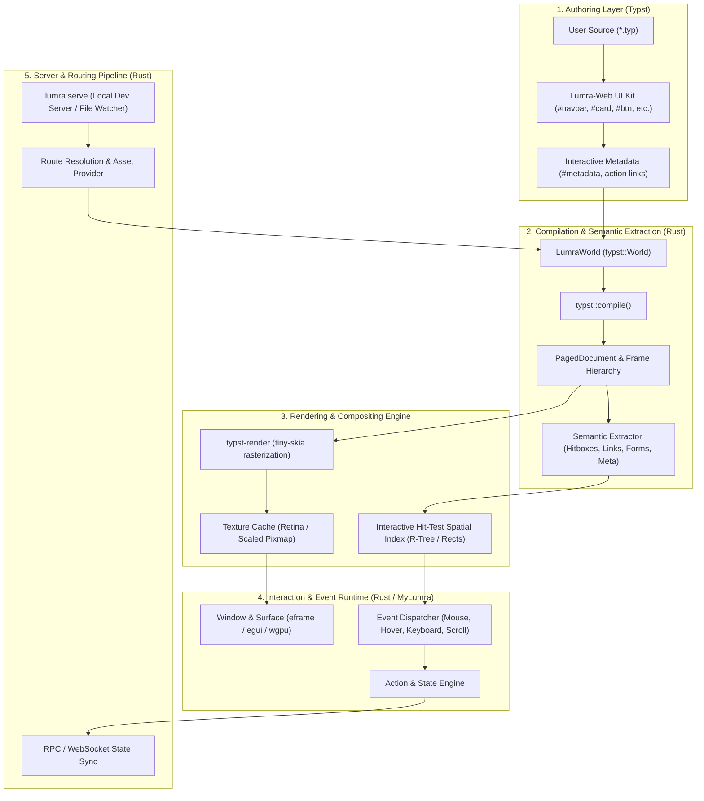

# Lumra-Web: System Architecture

> **Document Status:** Architectural Proposal (Draft)  
> **Author:** Systems Architecture Team  
> **Target Audience:** Systems Engineers, Compiler Specialists, Core Maintainers  

---

## 1. High-Level Architectural Overview

Lumra-Web structures web authoring and execution into a layered pipeline. It separates the declarative document UI (written in Typst) from the imperative runtime, event handling, and rendering pipeline (implemented in Rust).

---

## 2. Layer-by-Layer Architectural Breakdown

### 2.1 Layer 1: Authoring & UI Composition Layer (Typst)
* **Language:** Pure Typst (`.typ`).
* **Role:** Declarative description of document layout, typography, visual hierarchy, theme parameters, and content.
* **Component Abstractions:**
  - Layout: `web-page(title, theme, max-width, header, footer)`
  - Navigation: `navbar(brand, links, cta)`
  - Content Containers: `hero(...)`, `card(...)`, `grid-layout(...)`, `callout(...)`
  - Elements: `badge(...)`, `btn(...)`, `footer(...)`
* **Semantic Tagging:** Interactive elements (buttons, inputs, toggles) are tagged using Typst's `#metadata(...)` and action protocols (`lumra-action://...`), embedding behavioral intents directly into the layout frame without requiring JavaScript.

### 2.2 Layer 2: Compiler & World Abstraction (Rust / `typst` crate)
* **Core Crate:** `typst 0.13`
* **Custom World (`LumraWorld`):**
  - Implements `typst::World`.
  - In-memory source management (no disk I/O bottlenecks during live rendering).
  - Virtual package resolver (`@preview/lumra-web` mapped directly in memory or local workspace).
  - Asset fetcher supporting `file://`, `https://`, and `lumra://` schemes.
  - Dynamic input injection via `sys.inputs` (`viewport-width`, `viewport-height`, `session-state`).
* **Compilation Output:** `typst::layout::PagedDocument` consisting of a recursive tree of `Frame` objects.

### 2.3 Layer 3: Semantic Extraction & Hit-Testing Layer
Typst outputs a purely visual layout (`FrameItem::Text`, `FrameItem::Group`, `FrameItem::Shape`, `FrameItem::Image`, `FrameItem::Meta`, `FrameItem::Link`). This layer converts visual elements into interactive DOM-like abstractions:
1. **Link Extractor:** Traverses `FrameItem::Link` to construct screen-space bounding boxes and URL/action targets.
2. **Text Span Extractor:** Traverses `FrameItem::Text` to construct character and word bounding boxes for text selection, cursor positioning, and Find-in-Page (`Cmd+F`).
3. **Widget Metadata Extractor:** Reads `FrameItem::Meta` to detect custom widgets (buttons with callbacks, text input boundaries, checkbox toggles).
4. **Spatial Index:** Builds a 2D bounding-box index (AABB or R-Tree) for fast $O(\log n)$ mouse-picking and hover states.

### 2.4 Layer 4: Rendering & Compositing
* **Current Strategy:** Software rasterization via `typst-render` and `tiny-skia` into an in-memory 32-bit RGBA pixmap, uploaded to GPU texture memory (`egui::ColorImage` / OpenGL / Metal / Vulkan).
* **Continuous Scroll Buffer:** Instead of pagination, pages are rendered into a continuous vertical canvas (`page(height: auto)`).
* **Future GPU Vector Pipeline:** Direct rendering via `vello` or `wgpu` bypasses intermediate CPU bitmaps for native 120 FPS rendering.

### 2.5 Layer 5: Interaction & State Runtime
* **Event Dispatching:** Captures mouse movements, clicks, and keyboard strokes at the window surface level.
* **The Interactivity Model (Addressing Typst's Static Nature):**
  - *Challenge:* Typst is a pure functional compiler; it does not maintain a long-lived runtime state machine or event loop.
  - *Solution (Dual-Phase Interactivity):*
    - **Micro-Interactions (Client Overlay):** Hover states, cursor changes, text selection, and active input focus are handled immediately by the client runtime (e.g. `MyLumra` / `egui`) without re-compilation.
    - **Macro-Interactions (Stateful Re-compilation):** Actions that mutate page content (clicking a counter, toggling dark mode, submitting a form) update the state dictionary in the Rust runtime. Typst's memoized compiler re-compiles the document in memory with new `sys.inputs`. Because Typst's compilation speed is sub-15ms, full 60 FPS state updates are achievable without a heavy Virtual DOM reconciliation engine.

### 2.6 Layer 6: Backend, CLI, and Routing Services
* **Binary: `lumra-cli`:**
  - `lumra new <name>`: Scaffolds a new Typst-native web project.
  - `lumra serve`: Runs the local development server with file watching and WebSocket hot-reloading.
  - `lumra build`: Builds a production-ready package or bundle.
* **Server: `lumra-server`:**
  - Implemented with `axum` or `actix-web` in Rust.
  - File-based routing (`routes/index.typ` -> `/`, `routes/blog/[slug].typ` -> `/blog/:slug`).
  - WebSocket sync for instant live-reload in MyLumra browser.

---

## 3. Subsystem Classification: Libraries, Binaries, and Runtimes

| Subsystem | Type | Language | Responsibilities |
|---|---|---|---|
| `lumra-web` | Package / Library | Typst | Web component kit, themes, responsive continuous layout macros |
| `lumra-core` | Library | Rust | Shared AST metadata parser, link action protocol, `LumraWorld`, event types |
| `lumra-cli` / `lumra-server` | Binary | Rust | Project scaffolding, dev server, route resolution, file-watcher, asset pipeline |
| `MyLumra` | Binary / Runtime | Rust | Native browser desktop app (`eframe`/`egui`), raster/vector compositor, user navigation |

---

## 4. Current State vs Proposed Architecture

To maintain rigorous engineering honesty, here is the exact separation between what is working today and what is proposed:

| Architectural Component | Status | Location / Implementation Details |
|---|---|---|
| **Typst Compiler Integration** | ✅ Implemented | `MyLumra`: `typst 0.13`, in-memory `LumraWorld`, font caching |
| **Raster 2x Retina Rendering** | ✅ Implemented | `MyLumra`: `typst-render 0.13`, `tiny-skia` pixmap to `egui::ColorImage` |
| **Link Hit-Testing & Navigation** | ✅ Implemented | `MyLumra`: `extract_items` extracts `FrameItem::Link`, hover cursor, click routing |
| **Text Selection & Search** | ✅ Implemented | `MyLumra`: `extract_items` extracts `FrameItem::Text`, selection rects, Find (`Cmd+F`) |
| **Viewport Size Injection** | ✅ Implemented | `MyLumra`: Passes `viewport-width` and `viewport-height` through `sys.inputs` |
| **Typst Web Layout & Themes** | ✅ Implemented | `lumra-web`: `web-page`, 5 themes, `badge`, `btn`, `card`, `callout`, `grid`, `footer` |
| **Interactive Button Actions (Non-Link)** | 🟡 Proposed | Protocol `lumra-action://<action_name>` to trigger Rust state updates |
| **Interactive Form Inputs (Text/Checkbox)** | 🟡 Proposed | Semantic metadata tagging in Typst with native overlay controls |
| **Incremental State Re-compilation Loop** | 🟡 Proposed | Rust event loop mutating `sys.inputs` and triggering in-memory recompile |
| **Dev Server & Hot-Reload (`lumra serve`)** | 🟡 Proposed | Rust CLI with file-watching, WebSocket push, and local route serving |
| **Multi-Page File-Based Routing** | 🟡 Proposed | Routing engine mapping URL paths to `.typ` files with route parameters |
| **GPU Vector Pipeline (Vello/wgpu)** | 🔵 Future Target | Replacing software rasterization with GPU path tessellation |
